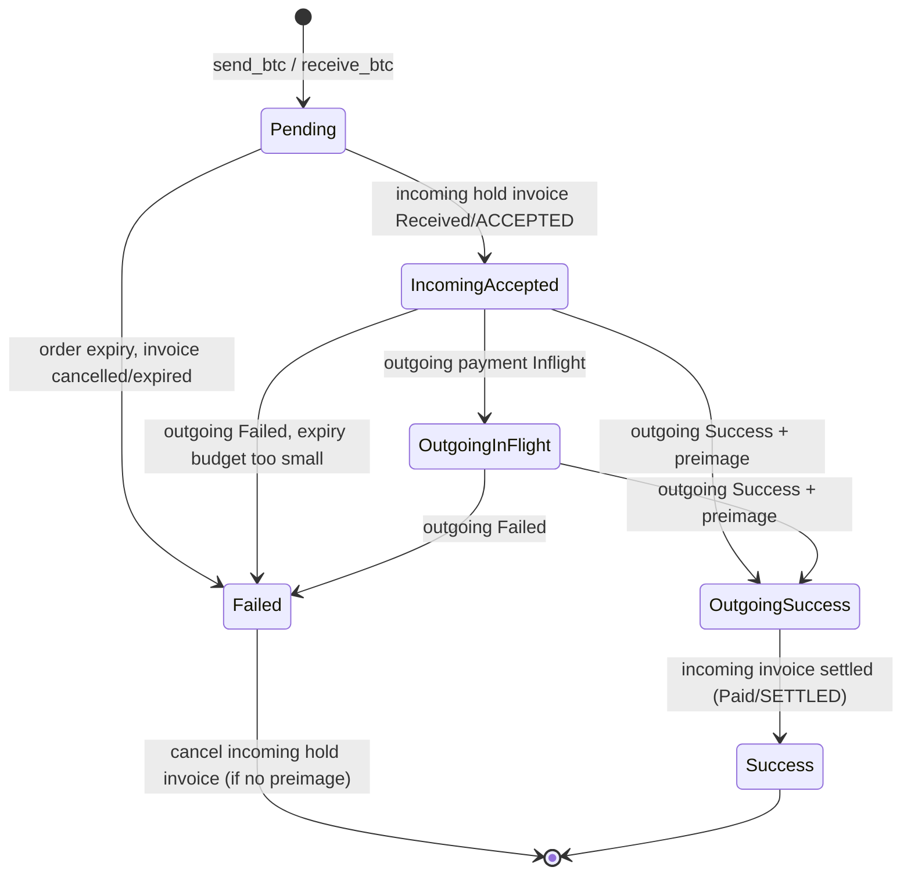

# Fiber Cross-Chain Hub (CCH): research for the CKBolt hub

Research date: 2026-10-23. Everything below was read from source, not memory.

| What was read | Ref | Date |
| --- | --- | --- |
| Default branch `develop` | [`2620b5b3`](https://github.com/nervosnetwork/fiber/commit/2620b5b3fdca082092ce57797d0c22b65c33af59) | 2026-10-19 |
| Latest release `v0.9.1` (marked "Latest") | [`9a561b3e`](https://github.com/nervosnetwork/fiber/commit/9a561b3e7b786001488b61303a0663d9f4f22259) | published 2026-09-11 |
| Latest prerelease `v0.10.0-rc1` | [`647a7203`](https://github.com/nervosnetwork/fiber/commit/647a7203582a0b07955b9b8ba5e63826e0063753) | published 2026-09-25 |
| Open PR #1257 "CCH multi-asset swap" (head) | [`8f6064a1`](https://github.com/nervosnetwork/fiber/pull/1257) | last update 2026-08-31 |

Verified with `git diff`: the CCH code (`crates/fiber-lib/src/cch/`, `rpc/cch.rs`, `fiber-types/src/cch.rs`,
`fiber-json-types/src/cch.rs`), the invoice and payment RPC, the CCH specs and the CCH e2e tests are **identical in
v0.9.0, v0.9.1, v0.10.0-rc1 and develop**. The last CCH change is #1609 (2026-08-06). So the permalinks below point at
the v0.9.1 commit `9a561b3e` and describe develop as well. Where a cited file differs between v0.9.1 and develop
(network.rs, channel.rs, fiber/config.rs, store, biscuit, main.rs, RPC README), line numbers are for v0.9.1.

Legend: **[V]** verified in source or in the repo/issue tracker. **[I]** inferred (reasoning, or knowledge of LND that was
not checked against LND source in this pass).

Link prefixes used below:
- `V/` = `https://github.com/nervosnetwork/fiber/blob/9a561b3e7b786001488b61303a0663d9f4f22259/`
- `D/` = `https://github.com/nervosnetwork/fiber/blob/2620b5b3fdca082092ce57797d0c22b65c33af59/`

All links are written out in full.

---

## 0. Key findings for the CKBolt hub

1. **CCH can already run as a separate process that only uses public fnn RPC** (standalone mode, `cch.fiber_rpc_url`,
   added by PR #1165, 2026-03-23). It uses `new_invoice` (hold invoice), `get_invoice`, `send_payment` (incl. `dry_run`),
   `get_payment`, `settle_invoice`, `cancel_invoice`, and the WebSocket subscription `subscribe_store_changes`. This is
   run in CI (`e2e/cross-chain-hub-separate`). It proves that an external CKBolt hub can do the same flow. [V]
2. **`get_payment` returns `payment_preimage`** ("The preimage learned from a successful payment attempt"). It was added
   in v0.9.0 (PR #1512, 2026-07-27); v0.8.1 does not have it. Minimum fnn for CKBolt: v0.9.0, use v0.9.1. [V]
3. **Hold invoices are part of the public Fiber RPC**: `new_invoice` with `payment_hash` and no `payment_preimage` makes
   a hold invoice; `settle_invoice(payment_hash, payment_preimage)` and `cancel_invoice(payment_hash)` resolve it. [V]
4. **The pricing problem is already being designed upstream**: open PR #1257 "feat!(cch): CCH multi-asset swap" adds
   native CKB and allowlisted UDTs, a fixed-rate fast path, and an operator "swap acceptor" over WebSocket
   (`subscribe_swap_proposals` / `submit_swap_proposal_response`) where an external operator sets the counterparty
   amount. Not merged; security reviews found issues. CKBolt should track it and decide whether to build on it. [V]
5. **Expiry rule to copy**: the incoming leg's final expiry is 60 h by default; the outgoing route may use at most half of
   what is left (`(incoming_final_delta - elapsed) / 2`), enforced through LND `cltv_limit` and Fiber
   `tlc_expiry_limit`. With defaults this leaves room for only about one intermediate hop on either side. [V for the rule,
   I for the hop count]
6. **The "16 h minimum `final_expiry_delta`" in Fiber's RPC docs (and, at research time, in CKBolt's `ckbolt-web/docs/context.md`) is stale.** The code
   enforces `MIN_TLC_EXPIRY_DELTA` = 1 epoch x 4 h x 2/3 = **160 minutes** in release builds (since 2025-09-01). [V]
7. **The devnet is reusable as is**: `tests/nodes/start.sh e2e/cross-chain-hub-separate` starts bitcoind regtest, two LND
   nodes (Bob, Ingrid = hub), a CKB devnet with UDTs, fnn nodes 1-3 and a standalone CCH. CI uses Bitcoin Core 27.0,
   LND v0.18.0-beta, CKB 0.202.0. There is no docker compose. [V]

---

## 1. Where CCH lives and how it works

### 1.1 Files [V]

| Path | Role |
| --- | --- |
| [`crates/fiber-lib/src/cch/actor.rs`](https://github.com/nervosnetwork/fiber/blob/9a561b3e7b786001488b61303a0663d9f4f22259/crates/fiber-lib/src/cch/actor.rs) | `CchActor`: RPC entry points, order creation, validation, tracking-event handling, startup recovery, WebSocket subscription |
| [`cch/config.rs`](https://github.com/nervosnetwork/fiber/blob/9a561b3e7b786001488b61303a0663d9f4f22259/crates/fiber-lib/src/cch/config.rs) | `CchConfig` and defaults |
| [`cch/cch_fiber_agent.rs`](https://github.com/nervosnetwork/fiber/blob/9a561b3e7b786001488b61303a0663d9f4f22259/crates/fiber-lib/src/cch/cch_fiber_agent.rs) | Fiber backend: in-process network actor, or HTTP JSON-RPC to an external fnn |
| [`cch/order/state_machine.rs`](https://github.com/nervosnetwork/fiber/blob/9a561b3e7b786001488b61303a0663d9f4f22259/crates/fiber-lib/src/cch/order/state_machine.rs) | Order FSM |
| [`cch/order/order_store.rs`](https://github.com/nervosnetwork/fiber/blob/9a561b3e7b786001488b61303a0663d9f4f22259/crates/fiber-lib/src/cch/order/order_store.rs) | Persistence trait |
| [`cch/actions/*.rs`](https://github.com/nervosnetwork/fiber/tree/9a561b3e7b786001488b61303a0663d9f4f22259/crates/fiber-lib/src/cch/actions) | Side effects: track invoice, send payment, track payment, settle, cancel |
| [`cch/trackers/lnd_trackers.rs`](https://github.com/nervosnetwork/fiber/blob/9a561b3e7b786001488b61303a0663d9f4f22259/crates/fiber-lib/src/cch/trackers/lnd_trackers.rs) | LND invoice and payment stream trackers |
| [`cch/scheduler.rs`](https://github.com/nervosnetwork/fiber/blob/9a561b3e7b786001488b61303a0663d9f4f22259/crates/fiber-lib/src/cch/scheduler.rs) | Order expiry and pruning timers |
| [`cch/tests/`](https://github.com/nervosnetwork/fiber/tree/9a561b3e7b786001488b61303a0663d9f4f22259/crates/fiber-lib/src/cch/tests) | ~7,500 lines of unit tests (actor, dispatcher, FSM, scheduler, LND trackers) |
| [`crates/fiber-lib/src/rpc/cch.rs`](https://github.com/nervosnetwork/fiber/blob/9a561b3e7b786001488b61303a0663d9f4f22259/crates/fiber-lib/src/rpc/cch.rs) | JSON-RPC methods |
| [`crates/fiber-types/src/cch.rs`](https://github.com/nervosnetwork/fiber/blob/9a561b3e7b786001488b61303a0663d9f4f22259/crates/fiber-types/src/cch.rs) | `CchOrder`, `CchOrderStatus`, creation intents |
| [`crates/fiber-json-types/src/cch.rs`](https://github.com/nervosnetwork/fiber/blob/9a561b3e7b786001488b61303a0663d9f4f22259/crates/fiber-json-types/src/cch.rs) | RPC params and response types |
| [`crates/fiber-lib/src/rpc/pubsub.rs`](https://github.com/nervosnetwork/fiber/blob/9a561b3e7b786001488b61303a0663d9f4f22259/crates/fiber-lib/src/rpc/pubsub.rs) | `subscribe_store_changes` WebSocket endpoint used by standalone CCH |
| [`docs/specs/cross-chain-htlc.md`](https://github.com/nervosnetwork/fiber/blob/9a561b3e7b786001488b61303a0663d9f4f22259/docs/specs/cross-chain-htlc.md), [`docs/specs/cch-expiry-dependency.md`](https://github.com/nervosnetwork/fiber/blob/9a561b3e7b786001488b61303a0663d9f4f22259/docs/specs/cch-expiry-dependency.md) | Specs (section 3) |

LND is reached over gRPC with the crate `lnd-grpc-tonic-client` 0.3.0
([`crates/fiber-lib/Cargo.toml` L65](https://github.com/nervosnetwork/fiber/blob/9a561b3e7b786001488b61303a0663d9f4f22259/crates/fiber-lib/Cargo.toml#L65)). [V]

### 1.2 Order types [V]

The names have not changed: **`send_btc`** and **`receive_btc`**
([`actor.rs` L58-L67](https://github.com/nervosnetwork/fiber/blob/9a561b3e7b786001488b61303a0663d9f4f22259/crates/fiber-lib/src/cch/actor.rs#L58-L67)).
An order is keyed by its payment hash. Which leg is incoming is stored as `incoming_invoice: CchInvoice::Fiber | Lightning`;
the payment leg is "the other network"
([`actions/backend_dispatchers.rs`](https://github.com/nervosnetwork/fiber/blob/9a561b3e7b786001488b61303a0663d9f4f22259/crates/fiber-lib/src/cch/actions/backend_dispatchers.rs)).

**`send_btc` (Fiber in, Lightning out).** Input: a BOLT11 `btc_pay_req` (from the Lightning payee) and `currency`
(`Fibb`/`Fibt`/`Fibd`). [`send_btc()` L1250-L1382](https://github.com/nervosnetwork/fiber/blob/9a561b3e7b786001488b61303a0663d9f4f22259/crates/fiber-lib/src/cch/actor.rs#L1250-L1382):
- BOLT11 network must match the fnn network (`Fibb`->bitcoin, `Fibt`->testnet, `Fibd`->regtest,
  [L974-L980](https://github.com/nervosnetwork/fiber/blob/9a561b3e7b786001488b61303a0663d9f4f22259/crates/fiber-lib/src/cch/actor.rs#L974-L980)); invoice timestamp not in the future; amount required.
- Static expiry check: `min_final_cltv_expiry_delta * 600 s < ckb_final_tlc_expiry_delta_seconds / 2`
  ([L1295-L1305](https://github.com/nervosnetwork/fiber/blob/9a561b3e7b786001488b61303a0663d9f4f22259/crates/fiber-lib/src/cch/actor.rs#L1295-L1305)).
- Incoming invoice lifetime = `min(BOLT11 expires_at - now, order_expiry_delta_seconds)`, must be >=
  `min_outgoing_invoice_expiry_delta_seconds` ([L1307-L1317](https://github.com/nervosnetwork/fiber/blob/9a561b3e7b786001488b61303a0663d9f4f22259/crates/fiber-lib/src/cch/actor.rs#L1307-L1317)).
- Builds a **Fiber hold invoice** with the same payment hash, `hash_algorithm = Sha256`, amount
  `ceil(msat/1000) + fee_sats` in wrapped-BTC units, `final_expiry_delta = ckb_final_tlc_expiry_delta_seconds * 1000`,
  `udt_type_script = wrapped BTC`, signed by the node key, expiry capped at the BTC/order deadline
  ([L1335-L1358](https://github.com/nervosnetwork/fiber/blob/9a561b3e7b786001488b61303a0663d9f4f22259/crates/fiber-lib/src/cch/actor.rs#L1335-L1358),
  [L1642-L1682](https://github.com/nervosnetwork/fiber/blob/9a561b3e7b786001488b61303a0663d9f4f22259/crates/fiber-lib/src/cch/actor.rs#L1642-L1682)).
- Reserves an LND payment-tracker slot (max 100), writes a durable creation intent, then adds the invoice to fnn.

**`receive_btc` (Lightning in, Fiber out).** Input: a signed Fiber invoice `fiber_pay_req` (from the Fiber payee).
[`receive_btc()` L1715-L1853](https://github.com/nervosnetwork/fiber/blob/9a561b3e7b786001488b61303a0663d9f4f22259/crates/fiber-lib/src/cch/actor.rs#L1715-L1853):
- Currency must match; amount required; `hash_algorithm` must be Sha256; `udt_script` must equal the configured
  wrapped-BTC script exactly (native CKB invoices are rejected).
- Static expiry check: payee `final_tlc_minimum_expiry_delta < btc_final_tlc_expiry_delta_blocks * 600_000 ms / 2`
  ([L1754-L1770](https://github.com/nervosnetwork/fiber/blob/9a561b3e7b786001488b61303a0663d9f4f22259/crates/fiber-lib/src/cch/actor.rs#L1754-L1770)).
- Remaining Fiber invoice expiry >= 6 h (an invoice without expiry is treated as 2 x 6 h)
  ([L1684-L1713](https://github.com/nervosnetwork/fiber/blob/9a561b3e7b786001488b61303a0663d9f4f22259/crates/fiber-lib/src/cch/actor.rs#L1684-L1713)).
- **Preflight**: `send_payment` with `dry_run: true` to check a route exists before exposing a payable LND invoice
  ([L1805-L1819](https://github.com/nervosnetwork/fiber/blob/9a561b3e7b786001488b61303a0663d9f4f22259/crates/fiber-lib/src/cch/actor.rs#L1805-L1819), PR #1555).
- Creates an **LND hold invoice** ([L2063-L2110](https://github.com/nervosnetwork/fiber/blob/9a561b3e7b786001488b61303a0663d9f4f22259/crates/fiber-lib/src/cch/actor.rs#L2063-L2110)):

```rust
invoicesrpc::AddHoldInvoiceRequest {
    hash: creation.payment_hash.as_ref().to_vec(),
    value_msat: total_msat,                 // (amount_sats + fee_sats) * 1000
    expiry: expiry as i64,                  // min(Fiber invoice remaining, order remaining), seconds
    cltv_expiry: creation.btc_final_tlc_expiry_delta_blocks, // 360 by default
    ..Default::default()
}
```

  A failed `AddHoldInvoice` is reconciled with `LookupInvoiceV2` by hash, because the call may have succeeded.

### 1.3 Order state machine [V]

States ([`fiber-types/src/cch.rs` L11-L26](https://github.com/nervosnetwork/fiber/blob/9a561b3e7b786001488b61303a0663d9f4f22259/crates/fiber-types/src/cch.rs#L11-L26)):

| State | Meaning |
| --- | --- |
| `Pending` (0) | Order created, incoming invoice waiting for TLCs/HTLCs |
| `IncomingAccepted` (1) | Incoming hold invoice is fully paid and held; outgoing payment may start |
| `OutgoingInFlight` (2) | Outgoing payment in flight |
| `OutgoingSuccess` (3) | Outgoing payment succeeded, preimage known |
| `Success` (4) | Incoming invoice settled too |
| `Failed` (5) | Order failed |

Allowed transitions ([`state_machine.rs` L92-L115](https://github.com/nervosnetwork/fiber/blob/9a561b3e7b786001488b61303a0663d9f4f22259/crates/fiber-lib/src/cch/order/state_machine.rs#L92-L115)):
`Pending->IncomingAccepted`, `IncomingAccepted->OutgoingInFlight|OutgoingSuccess`, `OutgoingInFlight->OutgoingSuccess`,
`OutgoingSuccess->Success`, any state except `Success`/`OutgoingSuccess` `->Failed`, and self-loops.

Events and guards ([L29-L90](https://github.com/nervosnetwork/fiber/blob/9a561b3e7b786001488b61303a0663d9f4f22259/crates/fiber-lib/src/cch/order/state_machine.rs#L29-L90)):
- Incoming invoice status maps `Open->Pending`, `Received->IncomingAccepted`, `Paid->Success`,
  `Cancelled|Expired->Failed`. A failure of the incoming invoice is **ignored** while the order is `OutgoingInFlight` or
  `OutgoingSuccess` (the outgoing leg may still deliver a preimage).
- Outgoing payment status maps `Created->IncomingAccepted`, `Inflight->OutgoingInFlight`, `Success->OutgoingSuccess`,
  `Failed->Failed`. Payment events are rejected in `Pending` (only the incoming tracker can accept an order).
- `Success` without a preimage is an error; a preimage must satisfy `sha256(preimage) == payment_hash`.
- A `Received` event for a `Pending` order past its deadline fails the order instead
  ([`actor.rs` L2206-L2237](https://github.com/nervosnetwork/fiber/blob/9a561b3e7b786001488b61303a0663d9f4f22259/crates/fiber-lib/src/cch/actor.rs#L2206-L2237)).

LND states are mapped onto the same enums: invoice `OPEN->Open`, `ACCEPTED->Received`, `SETTLED->Paid`,
`CANCELED->Cancelled`; payment `UNKNOWN|INITIATED->Created`, `IN_FLIGHT->Inflight`, `SUCCEEDED->Success`,
`FAILED->Failed` ([`lnd_trackers.rs` L979-L998](https://github.com/nervosnetwork/fiber/blob/9a561b3e7b786001488b61303a0663d9f4f22259/crates/fiber-lib/src/cch/trackers/lnd_trackers.rs#L979-L998)).

Actions on entering a state ([`actions/mod.rs` L62-L96](https://github.com/nervosnetwork/fiber/blob/9a561b3e7b786001488b61303a0663d9f4f22259/crates/fiber-lib/src/cch/actions/mod.rs#L62-L96)):

| State | Actions |
| --- | --- |
| Pending | TrackIncomingInvoice |
| IncomingAccepted | SendOutgoingPayment, TrackOutgoingPayment |
| OutgoingInFlight | TrackOutgoingPayment |
| OutgoingSuccess | SettleIncomingInvoice |
| Success | none |
| Failed | CancelIncomingInvoice, only if no preimage is known |

On restart (`on_starting`), TrackIncomingInvoice is added for IncomingAccepted/OutgoingInFlight/OutgoingSuccess.



### 1.4 LND calls [V]

| LND gRPC call | Used for | Source |
| --- | --- | --- |
| `invoicesrpc.AddHoldInvoice` | `receive_btc`: incoming hold invoice | [`actor.rs` L2079-L2110](https://github.com/nervosnetwork/fiber/blob/9a561b3e7b786001488b61303a0663d9f4f22259/crates/fiber-lib/src/cch/actor.rs#L2079-L2110) |
| `invoicesrpc.LookupInvoiceV2` (by payment hash) | Reconcile an ambiguous `AddHoldInvoice` and recover creations after restart | [`actor.rs` L96-L115](https://github.com/nervosnetwork/fiber/blob/9a561b3e7b786001488b61303a0663d9f4f22259/crates/fiber-lib/src/cch/actor.rs#L96-L115) |
| `invoicesrpc.SubscribeSingleInvoice` | Track the incoming hold invoice until SETTLED/CANCELED | [`lnd_trackers.rs` L882-L933](https://github.com/nervosnetwork/fiber/blob/9a561b3e7b786001488b61303a0663d9f4f22259/crates/fiber-lib/src/cch/trackers/lnd_trackers.rs#L882-L933) |
| `invoicesrpc.SettleInvoice` (preimage) | Settle incoming LND invoice | [`settle_incoming_invoice.rs` L77-L124](https://github.com/nervosnetwork/fiber/blob/9a561b3e7b786001488b61303a0663d9f4f22259/crates/fiber-lib/src/cch/actions/settle_incoming_invoice.rs#L77-L124) |
| `invoicesrpc.CancelInvoice` (payment_hash) | Refund: cancel incoming LND invoice | [`cancel_incoming_invoice.rs` L47-L87](https://github.com/nervosnetwork/fiber/blob/9a561b3e7b786001488b61303a0663d9f4f22259/crates/fiber-lib/src/cch/actions/cancel_incoming_invoice.rs#L47-L87) |
| `routerrpc.SendPaymentV2` | `send_btc`: pay the BOLT11 (`timeout_seconds: 60`, `cltv_limit`, `fee_limit_sat`); only the first stream update is read | [`send_outgoing_payment.rs` L133-L200](https://github.com/nervosnetwork/fiber/blob/9a561b3e7b786001488b61303a0663d9f4f22259/crates/fiber-lib/src/cch/actions/send_outgoing_payment.rs#L133-L200) |
| `routerrpc.TrackPaymentV2` (one stream per hash, `no_inflight_updates: false`) | Follow the outgoing payment to a terminal state; returns current state after reconnect | [`lnd_trackers.rs` L766-L846](https://github.com/nervosnetwork/fiber/blob/9a561b3e7b786001488b61303a0663d9f4f22259/crates/fiber-lib/src/cch/trackers/lnd_trackers.rs#L766-L846) |

Not used: `lnrpc.SubscribeInvoices`, `routerrpc.TrackPayments` (removed by PR #1546 because the global stream did not
replay terminal states missed while CCH was down), `AddInvoice`, REST. Connection: `lnd_rpc_url` (gRPC, default
`https://127.0.0.1:10009`), optional TLS cert (empty = well-known CAs), optional macaroon file
([`actor.rs` L300-L317](https://github.com/nervosnetwork/fiber/blob/9a561b3e7b786001488b61303a0663d9f4f22259/crates/fiber-lib/src/cch/actor.rs#L300-L317)).
[I] A production macaroon needs at least invoices read/write and offchain read/write (standard LND permissions for these
calls); a restricted macaroon is better than `admin.macaroon`.

Limits ([`lnd_trackers.rs` L50-L55](https://github.com/nervosnetwork/fiber/blob/9a561b3e7b786001488b61303a0663d9f4f22259/crates/fiber-lib/src/cch/trackers/lnd_trackers.rs#L50-L55)):
max 100 tracked LND invoices and 100 tracked LND payments (new orders fail with "capacity exceeded"), at most 10
concurrent subscribe attempts, 15 s subscribe timeout, 15 s + 0-15 s jitter retry for invoice streams, 15 s retry for
payment streams.

### 1.5 Fiber calls [V]

Two backends ([`cch_fiber_agent.rs`](https://github.com/nervosnetwork/fiber/blob/9a561b3e7b786001488b61303a0663d9f4f22259/crates/fiber-lib/src/cch/cch_fiber_agent.rs)):
in-process (messages to the fnn `NetworkActor`) or HTTP JSON-RPC when `cch.fiber_rpc_url` is set. The HTTP backend calls:

| fnn RPC | CCH use | Source |
| --- | --- | --- |
| `new_invoice` with `payment_hash`, no `payment_preimage`, `hash_algorithm`, `expiry`, `final_expiry_delta`, `udt_type_script`, `allow_mpp` | `send_btc` incoming hold invoice | [L253-L290](https://github.com/nervosnetwork/fiber/blob/9a561b3e7b786001488b61303a0663d9f4f22259/crates/fiber-lib/src/cch/cch_fiber_agent.rs#L253-L290) |
| `get_invoice` | Recovery; error classification | [L292-L309](https://github.com/nervosnetwork/fiber/blob/9a561b3e7b786001488b61303a0663d9f4f22259/crates/fiber-lib/src/cch/cch_fiber_agent.rs#L292-L309) |
| `send_payment` (`invoice`, `tlc_expiry_limit`, `max_fee_amount`, `max_fee_rate`, `dry_run`) | `receive_btc` outgoing payment and preflight | [L311-L360](https://github.com/nervosnetwork/fiber/blob/9a561b3e7b786001488b61303a0663d9f4f22259/crates/fiber-lib/src/cch/cch_fiber_agent.rs#L311-L360) |
| `get_payment` | Track outgoing payment, read `payment_preimage` | [L476-L484](https://github.com/nervosnetwork/fiber/blob/9a561b3e7b786001488b61303a0663d9f4f22259/crates/fiber-lib/src/cch/cch_fiber_agent.rs#L476-L484) |
| `settle_invoice` (`payment_hash`, `payment_preimage`) | Settle incoming Fiber hold invoice | [L362-L379](https://github.com/nervosnetwork/fiber/blob/9a561b3e7b786001488b61303a0663d9f4f22259/crates/fiber-lib/src/cch/cch_fiber_agent.rs#L362-L379) |
| `cancel_invoice` (`payment_hash`) | Refund incoming Fiber hold invoice | [L421-L436](https://github.com/nervosnetwork/fiber/blob/9a561b3e7b786001488b61303a0663d9f4f22259/crates/fiber-lib/src/cch/cch_fiber_agent.rs#L421-L436) |
| WS `subscribe_store_changes` / `unsubscribe_store_changes` | Push events: invoice status, payment session (with preimage), attempt status | [`actor.rs` L2507-L2601](https://github.com/nervosnetwork/fiber/blob/9a561b3e7b786001488b61303a0663d9f4f22259/crates/fiber-lib/src/cch/actor.rs#L2507-L2601) |

HTTP request timeout 60 s; the HTTP Fiber invoice expiry is shortened by 61 s so the remote timestamp plus expiry stays
inside the order deadline ([L123-L147](https://github.com/nervosnetwork/fiber/blob/9a561b3e7b786001488b61303a0663d9f4f22259/crates/fiber-lib/src/cch/cch_fiber_agent.rs#L123-L147)).
The WS URL is the HTTP URL with `http`->`ws`; reconnect every 5 s; after each (re)subscribe the actor re-queries all
`IncomingAccepted`/`OutgoingInFlight` orders with `get_payment` (`ReconcileFiberPayments`,
[`actor.rs` L789-L809](https://github.com/nervosnetwork/fiber/blob/9a561b3e7b786001488b61303a0663d9f4f22259/crates/fiber-lib/src/cch/actor.rs#L789-L809)).
Store changes are mapped to events in
[`map_store_change_to_events` L2312-L2353](https://github.com/nervosnetwork/fiber/blob/9a561b3e7b786001488b61303a0663d9f4f22259/crates/fiber-lib/src/cch/actor.rs#L2312-L2353);
`PutPreimage` is deliberately ignored:

```rust
// Preimages are global to a Fiber node and can be learned from unrelated TLCs
// that reuse the same payment hash. Only the correlated PaymentSession success
// above is authoritative for a CCH outgoing payment.
StoreChange::PutPreimage { .. } => vec![],
```

### 1.6 How the preimage is obtained [V]

| Direction | Outgoing leg | Preimage source | Then |
| --- | --- | --- | --- |
| `send_btc` | LND pays BOLT11 | `TrackPaymentV2` (and the first `SendPaymentV2` update) -> `Payment.payment_preimage` (hex) when `SUCCEEDED`. LND sends an all-zero placeholder before success; CCH treats zeros as "no preimage" unless the status is `SUCCEEDED` ([L942-L967](https://github.com/nervosnetwork/fiber/blob/9a561b3e7b786001488b61303a0663d9f4f22259/crates/fiber-lib/src/cch/trackers/lnd_trackers.rs#L942-L967), PR #1521) | fnn `settle_invoice(hash, preimage)` |
| `receive_btc` | fnn pays Fiber invoice | `StoreChange::PutPaymentSession { payment_preimage }` over WS (or the in-process port), and `get_payment` -> `payment_preimage`. A `Success` without a preimage is retried ([`cch_fiber_agent.rs` L983-L1010](https://github.com/nervosnetwork/fiber/blob/9a561b3e7b786001488b61303a0663d9f4f22259/crates/fiber-lib/src/cch/cch_fiber_agent.rs#L983-L1010)) | LND `SettleInvoice(preimage)` |

In both directions the FSM checks `sha256(preimage) == payment_hash` before storing it.

### 1.7 Settle and cancel [V]

- Settle runs in `OutgoingSuccess`. Fiber: `AlreadyPaid` -> treated as `Paid`; permanent errors (not found, hash
  mismatch, still open, cancelled, expired) -> an `InvoiceChanged(Cancelled)` event; transient -> retry
  ([`settle_incoming_invoice.rs` L28-L68](https://github.com/nervosnetwork/fiber/blob/9a561b3e7b786001488b61303a0663d9f4f22259/crates/fiber-lib/src/cch/actions/settle_incoming_invoice.rs#L28-L68)).
  LND: only `InvalidArgument` is permanent.
- **Consequence [V code, I impact]:** that `Cancelled` event is ignored by the FSM in `OutgoingSuccess`
  ([`state_machine.rs` L39-L46](https://github.com/nervosnetwork/fiber/blob/9a561b3e7b786001488b61303a0663d9f4f22259/crates/fiber-lib/src/cch/order/state_machine.rs#L39-L46)),
  so the order stays in `OutgoingSuccess` with no further action: the hub paid out and could not collect. It needs
  monitoring and manual handling. CKBolt should alert on this state.
- Cancel runs only when `Failed` and no preimage is known
  ([`cancel_incoming_invoice.rs` L89-L92](https://github.com/nervosnetwork/fiber/blob/9a561b3e7b786001488b61303a0663d9f4f22259/crates/fiber-lib/src/cch/actions/cancel_incoming_invoice.rs#L89-L92));
  "already cancelled/paid/not found" style errors are logged and dropped.

### 1.8 Failures, retries and restarts [V]

- Transient action failures retry with backoff 1 s x 2^n, capped at 10 min, **with no retry limit**
  ([`actor.rs` L44-L56](https://github.com/nervosnetwork/fiber/blob/9a561b3e7b786001488b61303a0663d9f4f22259/crates/fiber-lib/src/cch/actor.rs#L44-L56),
  [L2464-L2487](https://github.com/nervosnetwork/fiber/blob/9a561b3e7b786001488b61303a0663d9f4f22259/crates/fiber-lib/src/cch/actor.rs#L2464-L2487)).
- Permanent outgoing-payment errors fail the order (then the incoming invoice is cancelled). Fiber permanent:
  `InvalidParameter`, "invalid payment request", "invoice expired", "payment hash mismatch", "no path found"
  ([`cch_fiber_agent.rs` L932-L941](https://github.com/nervosnetwork/fiber/blob/9a561b3e7b786001488b61303a0663d9f4f22259/crates/fiber-lib/src/cch/cch_fiber_agent.rs#L932-L941)).
  LND permanent: `InvalidArgument`, or `Unknown` containing "self-payments not allowed", "invoice is already paid",
  "invoice expired", "incorrect payment amount", "payment hash mismatch", "no route", "unable to find a path to
  destination" ([`send_outgoing_payment.rs` L234-L255](https://github.com/nervosnetwork/fiber/blob/9a561b3e7b786001488b61303a0663d9f4f22259/crates/fiber-lib/src/cch/actions/send_outgoing_payment.rs#L234-L255)).
- Idempotent re-sends: LND `AlreadyExists` and Fiber "Payment session already exists" are treated as `Inflight`.
- Order expiry: the scheduler fires `ExpireOrder` at `created_at + order_expiry_delta_seconds`, but it only fails
  orders still in `Pending` ([`actor.rs` L1141-L1170](https://github.com/nervosnetwork/fiber/blob/9a561b3e7b786001488b61303a0663d9f4f22259/crates/fiber-lib/src/cch/actor.rs#L1141-L1170)).
  After acceptance, only payment tracking and the HTLC/TLC expiries govern the order.
- Final orders are deleted 21 days after `created_at + expiry_delta`
  ([`scheduler.rs` L12-L13](https://github.com/nervosnetwork/fiber/blob/9a561b3e7b786001488b61303a0663d9f4f22259/crates/fiber-lib/src/cch/scheduler.rs#L12-L13)).

**Persistence.** Orders live in the node's own store (`CchOrderStore`, implemented by the fnn store, RocksDB or SQLite).
Before any external side effect, CCH writes a **durable creation intent** (`CchReceiveBtcOrderCreation` before
`AddHoldInvoice`, `CchSendBtcOrderCreation` before `new_invoice`), keyed by payment hash, and atomically swaps it for
the `CchOrder` when done ([`fiber-types/src/cch.rs` L96-L155](https://github.com/nervosnetwork/fiber/blob/9a561b3e7b786001488b61303a0663d9f4f22259/crates/fiber-types/src/cch.rs#L96-L155),
PRs #1573, #1602). A retried RPC with the same invoice returns the existing order; a different request with the same
hash is rejected (`ConflictingSendBTCRequest` / `ConflictingReceiveBTCRequest`).

**Restart** ([`actor.rs` L413-L449, L679-L744, L1055-L1106](https://github.com/nervosnetwork/fiber/blob/9a561b3e7b786001488b61303a0663d9f4f22259/crates/fiber-lib/src/cch/actor.rs#L1055-L1106)):
snapshot all order and intent keys, recover one per mailbox tick; while recovering, `send_btc`/`receive_btc` return
`StartupRecoveryInProgress` (`get_cch_order` still works, PR #1607). For each active order: expire it if still
`Pending` past its deadline, restore tracker reservations, re-schedule expiry, re-dispatch actions
(`SubscribeSingleInvoice` and `TrackPaymentV2` return the current state, so missed transitions are recovered;
Fiber payments via `get_payment`). In standalone mode the CCH process has its own store at
`base_dir/fiber/store` when no fiber section is configured
([`main.rs` L162-L178](https://github.com/nervosnetwork/fiber/blob/9a561b3e7b786001488b61303a0663d9f4f22259/crates/fiber-bin/src/main.rs#L162-L178)).

### 1.9 Timing and expiry parameters [V unless marked]

| Parameter | Default | Where | Purpose |
| --- | --- | --- | --- |
| `order_expiry_delta_seconds` | 36 h (129,600 s) | [config.rs L6](https://github.com/nervosnetwork/fiber/blob/9a561b3e7b786001488b61303a0663d9f4f22259/crates/fiber-lib/src/cch/config.rs#L6) | How long a `Pending` order waits for the incoming payment; also caps the incoming invoice expiry |
| `btc_final_tlc_expiry_delta_blocks` | 360 blocks (~60 h) | [L8](https://github.com/nervosnetwork/fiber/blob/9a561b3e7b786001488b61303a0663d9f4f22259/crates/fiber-lib/src/cch/config.rs#L8) | `cltv_expiry` of the LND hold invoice (`receive_btc` incoming leg) |
| `ckb_final_tlc_expiry_delta_seconds` | 60 h (216,000 s) | [L10](https://github.com/nervosnetwork/fiber/blob/9a561b3e7b786001488b61303a0663d9f4f22259/crates/fiber-lib/src/cch/config.rs#L10) | `final_expiry_delta` of the Fiber hold invoice (`send_btc` incoming leg) |
| `min_outgoing_invoice_expiry_delta_seconds` | 6 h | [L12](https://github.com/nervosnetwork/fiber/blob/9a561b3e7b786001488b61303a0663d9f4f22259/crates/fiber-lib/src/cch/config.rs#L12) | Reject client invoices expiring sooner; min lifetime of minted invoices |
| Static cross-leg check | outgoing final < incoming final / 2 | [actor.rs L1303](https://github.com/nervosnetwork/fiber/blob/9a561b3e7b786001488b61303a0663d9f4f22259/crates/fiber-lib/src/cch/actor.rs#L1303), [L1768](https://github.com/nervosnetwork/fiber/blob/9a561b3e7b786001488b61303a0663d9f4f22259/crates/fiber-lib/src/cch/actor.rs#L1768) | With defaults: BOLT11 `min_final_cltv` < 180 blocks; Fiber payee final delta < 30 h |
| Dynamic outgoing cap | `(incoming_final - elapsed) / 2` | [send_outgoing_payment.rs L278-L302](https://github.com/nervosnetwork/fiber/blob/9a561b3e7b786001488b61303a0663d9f4f22259/crates/fiber-lib/src/cch/actions/send_outgoing_payment.rs#L278-L302) | LND `cltv_limit = max/600` blocks; Fiber `tlc_expiry_limit = max*1000` ms, capped at 14 days |
| `BTC_BLOCK_TIME_MILLIS` | 600,000 | [actor.rs L49](https://github.com/nervosnetwork/fiber/blob/9a561b3e7b786001488b61303a0663d9f4f22259/crates/fiber-lib/src/cch/actor.rs#L49) | Blocks <-> time conversion |
| `BTC_PAYMENT_TIMEOUT_SECONDS` | 60 | [send_outgoing_payment.rs L23](https://github.com/nervosnetwork/fiber/blob/9a561b3e7b786001488b61303a0663d9f4f22259/crates/fiber-lib/src/cch/actions/send_outgoing_payment.rs#L23) | `SendPaymentV2.timeout_seconds` (LND gives up trying new routes) |
| LND hold invoice `expiry` | min(Fiber invoice remaining, order remaining) | [actor.rs L2072-L2083](https://github.com/nervosnetwork/fiber/blob/9a561b3e7b786001488b61303a0663d9f4f22259/crates/fiber-lib/src/cch/actor.rs#L2072-L2083) | PR #1608 |
| Fiber hold invoice `expiry` | min(BOLT11 expiry, order deadline) - now | [actor.rs L1607-L1682](https://github.com/nervosnetwork/fiber/blob/9a561b3e7b786001488b61303a0663d9f4f22259/crates/fiber-lib/src/cch/actor.rs#L1607-L1682) | Must be >= 6 h (+61 s in HTTP mode) |
| CCH RPC actor call timeout | 1,000 ms | [rpc/cch.rs L40](https://github.com/nervosnetwork/fiber/blob/9a561b3e7b786001488b61303a0663d9f4f22259/crates/fiber-lib/src/rpc/cch.rs#L40) | A slow creation returns a timeout; the client retries the same request (idempotent) |
| Action retry backoff | 1 s doubling, max 10 min | [actor.rs L44-L45](https://github.com/nervosnetwork/fiber/blob/9a561b3e7b786001488b61303a0663d9f4f22259/crates/fiber-lib/src/cch/actor.rs#L44-L45) | |
| Prune delay | 21 days | [scheduler.rs L12](https://github.com/nervosnetwork/fiber/blob/9a561b3e7b786001488b61303a0663d9f4f22259/crates/fiber-lib/src/cch/scheduler.rs#L12) | |

Fiber-wide constants that matter ([`fiber/config.rs` L36-L77, v0.9.1](https://github.com/nervosnetwork/fiber/blob/9a561b3e7b786001488b61303a0663d9f4f22259/crates/fiber-lib/src/fiber/config.rs#L36-L77)):

| Constant | Release build | Debug build (used by e2e) |
| --- | --- | --- |
| `DEFAULT_COMMITMENT_DELAY_EPOCHS` | 1 | 1 |
| `MILLI_SECONDS_PER_EPOCH` | 4 h | 2 s |
| `MIN_TLC_EXPIRY_DELTA` (min `final_expiry_delta`) | 1 x 4 h x 2/3 = **160 min** | ~1.3 s |
| `DEFAULT_TLC_EXPIRY_DELTA` (per forwarding hop) | 4 h | 4 h |
| `MAX_PAYMENT_TLC_EXPIRY_LIMIT` | 14 days | 14 days |
| `DEFAULT_HOLD_TLC_TIMEOUT` (MPP, before `Received`) | 120 s | 20 s |
| `DEFAULT_FINAL_TLC_EXPIRY_DELTA` (invoice without the attribute) | 24 h ([fiber-types invoice.rs L157](https://github.com/nervosnetwork/fiber/blob/9a561b3e7b786001488b61303a0663d9f4f22259/crates/fiber-types/src/invoice.rs#L157)) | 24 h |
| `new_invoice` RPC default `final_expiry_delta` when omitted | `MIN_TLC_EXPIRY_DELTA` ([rpc/invoice.rs L242](https://github.com/nervosnetwork/fiber/blob/9a561b3e7b786001488b61303a0663d9f4f22259/crates/fiber-lib/src/rpc/invoice.rs#L242)) | |

The RPC README and `NewInvoiceParams` doc still say "Minimal value is 16 hours"
([fiber-json-types invoice.rs L140-L141](https://github.com/nervosnetwork/fiber/blob/9a561b3e7b786001488b61303a0663d9f4f22259/crates/fiber-json-types/src/invoice.rs#L140-L141)).
16 h was 6 epochs x 4 h x 2/3; the delay became 1 epoch on 2025-09-01 (commit `e080b1a7`), so the doc is stale. [V]

Why these defaults [V from docs/PRs]: PR #1258 (2026-04-15) raised both final deltas from 30 h to 60 h; the expiry spec
says the defaults "ensure a 30-hour window to settle the outgoing payment" (half of 60 h). PR #1148 added the dynamic
cap after issue #1000 (multi-hop outgoing routes could exceed the incoming budget).

### 1.10 Fees and amounts [V]

- `send_btc`: `fee_sats = floor(amount_msat * fee_rate_per_million_sats / 1e9) + base_fee_sats`; Fiber invoice amount
  = `ceil(amount_msat / 1000) + fee_sats` ([actor.rs L1319-L1333](https://github.com/nervosnetwork/fiber/blob/9a561b3e7b786001488b61303a0663d9f4f22259/crates/fiber-lib/src/cch/actor.rs#L1319-L1333)).
- `receive_btc`: `fee_sats = floor(amount_sats * rate / 1e6) + base`; LND hold invoice `value_msat = (amount + fee) * 1000`.
- Outgoing routing budget = `fee_sats * max_outgoing_fee_percentage / 100` (80 % by default): LND `fee_limit_sat`;
  Fiber `max_fee_amount` plus `max_fee_rate = ceil(budget * 1000 / amount)` (per-thousand) so Fiber's default 0.5 %
  rate cap does not bind ([send_outgoing_payment.rs L25-L57](https://github.com/nervosnetwork/fiber/blob/9a561b3e7b786001488b61303a0663d9f4f22259/crates/fiber-lib/src/cch/actions/send_outgoing_payment.rs#L25-L57)).
- The rate between legs is fixed 1:1 (1 sat = 1 smallest unit of the wrapped-BTC UDT, which "must be a UDT with 8
  decimal places"). There is no pricing.
- e2e check values: 100,000 sat -> fee 400 (`0x190`); 50,000 -> fee 250 (`0xfa`).

---

## 2. CCH RPC and configuration

### 2.1 RPC methods [V]

Module "Cch" (described as "RPC module for cross chain hub demonstration"),
[`rpc/cch.rs` L8-L27](https://github.com/nervosnetwork/fiber/blob/9a561b3e7b786001488b61303a0663d9f4f22259/crates/fiber-lib/src/rpc/cch.rs#L8-L27),
[README L137-L214](https://github.com/nervosnetwork/fiber/blob/9a561b3e7b786001488b61303a0663d9f4f22259/crates/fiber-lib/src/rpc/README.md#L137-L214):

| Method | Params | Result |
| --- | --- | --- |
| `send_btc` | `btc_pay_req: String`, `currency: "Fibb" \| "Fibt" \| "Fibd"` | `CchOrderResponse` |
| `receive_btc` | `fiber_pay_req: String` | `CchOrderResponse` |
| `get_cch_order` | `payment_hash: Hash256` | `CchOrderResponse` |

`CchOrderResponse` ([fiber-json-types cch.rs L52-L91](https://github.com/nervosnetwork/fiber/blob/9a561b3e7b786001488b61303a0663d9f4f22259/crates/fiber-json-types/src/cch.rs#L52-L91)):
`timestamp` (u64 hex, seconds), `expiry_delta_seconds`, `wrapped_btc_type_script`, `incoming_invoice`
(`{"Fiber": "fibd..."}` or `{"Lightning": "lnbcrt..."}`), `outgoing_pay_req`, `payment_hash`, `amount_sats` (what the
incoming payer must pay, fee included, PR #1547), `fee_sats`, `status`. **Not exposed:** `failure_reason`,
`payment_preimage`; there is no list or admin method.

Biscuit auth rules ([biscuit.rs L93-L100, v0.9.1](https://github.com/nervosnetwork/fiber/blob/9a561b3e7b786001488b61303a0663d9f4f22259/crates/fiber-lib/src/rpc/biscuit.rs#L93-L100)):
`send_btc`/`receive_btc` need `write("cch")`, `get_cch_order` `read("cch")`, `subscribe_store_changes`
`internal("store_changes")`.

### 2.2 `cch` config section [V]

[`cch/config.rs`](https://github.com/nervosnetwork/fiber/blob/9a561b3e7b786001488b61303a0663d9f4f22259/crates/fiber-lib/src/cch/config.rs). Each key is also a CLI flag `--cch-<key>` and env var `CCH_<KEY>`.

| Key | Default | Notes |
| --- | --- | --- |
| `base_dir` | `$BASE_DIR/cch` | Relative cert/macaroon paths resolve against it |
| `lnd_rpc_url` | `https://127.0.0.1:10009` | LND gRPC (help text wrongly says http) |
| `lnd_cert_path` | none | Empty = well-known CAs |
| `lnd_macaroon_path` | none | |
| `wrapped_btc_type_script_args` | required | Hex args; script is built with the **SimpleUDT** contract code hash from the contracts context |
| `wrapped_btc_type_script` | none | Full script JSON `{"code_hash","hash_type","args"}`; overrides the args key; required in standalone mode (use it for xUDT tokens) |
| `order_expiry_delta_seconds` | 129,600 (36 h) | |
| `base_fee_sats` | 100 | Was 0 before PR #1603 (2026-08-05) |
| `fee_rate_per_million_sats` | 3,000 | Was 1 before PR #1603 |
| `max_outgoing_fee_percentage` | 80 | 1..=100, validated at startup |
| `btc_final_tlc_expiry_delta_blocks` | 360 | Was 180 before PR #1258 |
| `ckb_final_tlc_expiry_delta_seconds` | 216,000 (60 h) | Was 30 h before PR #1258 |
| `min_outgoing_invoice_expiry_delta_seconds` | 21,600 (6 h) | |
| `ignore_startup_failure` | false | Config file only (`#[arg(skip)]`) |
| `fiber_rpc_url` | none | `http[s]://host:port`; enables standalone mode (HTTP + `ws[s]://` subscription) |

Enabling: `services` must contain `cch` ([fiber-lib config.rs L249, develop](https://github.com/nervosnetwork/fiber/blob/2620b5b3fdca082092ce57797d0c22b65c33af59/crates/fiber-lib/src/config.rs#L249));
RPC module `cch` is in the default `rpc.enabled_modules` (`cch,channel,graph,payment,info,invoice,peer`, plus
`watchtower` with that feature), but **`pubsub` is not** ([rpc/config.rs L3-L6](https://github.com/nervosnetwork/fiber/blob/9a561b3e7b786001488b61303a0663d9f4f22259/crates/fiber-lib/src/rpc/config.rs#L3-L6),
[rpc/mod.rs L395-L410](https://github.com/nervosnetwork/fiber/blob/9a561b3e7b786001488b61303a0663d9f4f22259/crates/fiber-lib/src/rpc/mod.rs#L395-L410)).
A standalone CCH needs `pubsub` enabled on the fnn it connects to. RPC on a public address requires
`rpc.biscuit_public_key`.

Example (the e2e template, [`tests/nodes/deployer/config.yml`](https://github.com/nervosnetwork/fiber/blob/9a561b3e7b786001488b61303a0663d9f4f22259/tests/nodes/deployer/config.yml)):

```yaml
rpc:
  enabled_modules: [cch, channel, payment, graph, info, invoice, peer, pubsub, watchtower, dev, prof]
cch:
  ignore_startup_failure: true
  wrapped_btc_type_script_args: "0x32e555f3ff8e135cece1351a6a2971518392c1e30375c1e006ad0ce8eac07947"
  lnd_cert_path: ../../../deploy/lnd-init/lnd-ingrid/tls.cert
services: [fiber, rpc, ckb]   # udt-init adds cch for node 3
```

---

## 3. Specs: protocol and security

### 3.1 `docs/specs/cross-chain-htlc.md` [V]

[Link](https://github.com/nervosnetwork/fiber/blob/9a561b3e7b786001488b61303a0663d9f4f22259/docs/specs/cross-chain-htlc.md).
Three actors: Alice (payer, chain A), Bob (payee, chain B), Ingrid (hub with nodes on both). Bob knows the preimage;
Alice offers an HTLC to Ingrid; Ingrid offers an HTLC with the same hash to Bob; Bob reveals the preimage to claim; Ingrid
uses it to claim from Alice. Requirements: **same hash algorithm on both networks**, and a **fixed swap ratio** (the
example is a wrapped-BTC UDT at 1:1). Fee: the hub keeps F (X+F in, X out). Security argument given: atomicity of HTLCs
("either both are completed, or neither is"); routed payments on both sides are allowed. The doc does not discuss
expiry ordering; that is in the next spec. Future work: PTLCs.

### 3.2 `docs/specs/cch-expiry-dependency.md` [V]

[Link](https://github.com/nervosnetwork/fiber/blob/9a561b3e7b786001488b61303a0663d9f4f22259/docs/specs/cch-expiry-dependency.md).
"The incoming payment must leave sufficient expiry time for the outgoing payment to settle."

1. **Static check at order creation**: the outgoing invoice's final expiry must be less than half of the incoming final
   expiry the hub sets (BTC blocks converted at 10 min/block).
2. **Dynamic check when sending** (after the incoming leg is held): remaining =
   `incoming_final_expiry_delta - (now - order.created_at)` (conservative, because the incoming TLC was accepted at or
   after order creation); allow the outgoing route at most `remaining / 2`; fail the order if that is below the outgoing
   invoice's minimum final expiry; enforce it with LND `cltv_limit` and Fiber `tlc_expiry_limit`.
3. Reason: "even in the worst case, where the outgoing payment settles at the very last moment before its route expiry,
   CCH still has enough time to settle the incoming payment."

Ordering, as a rule: `outgoing route expiry <= now + (incoming expiry - now) / 2`, so the hub always has at least half of
the remaining incoming window after the latest possible preimage reveal.

### 3.3 What the defaults allow [I, arithmetic on V values]

- `send_btc`: incoming Fiber final = 60 h -> LND `cltv_limit` <= 180 blocks at t=0 (177 after 1 h). A typical BOLT11 has
  `min_final_cltv_expiry_delta` 80 (seen in issue #1287's log) and LND hops default to an 80-block delta, so the hub can
  reach the payee directly or through about one hop; two 80-block hops (240) exceed the cap and fail as "no route".
- `receive_btc`: incoming LND hold invoice CLTV = 360 blocks (~60 h) -> Fiber `tlc_expiry_limit` ~30 h. A payee invoice
  with the 24 h default final delta plus one 4 h Fiber hop fits (28 h); two hops (32 h) do not.
- Bitcoin blocks can arrive faster than 10 min; the 2x margin absorbs normal variance.
- Locked time for users: a Fiber payer's TLC is held up to ~60 h (+ route); a Lightning payer's HTLC up to 360 blocks
  (+ route). Raising the incoming deltas lets the outgoing side route further but locks payers longer and raises the
  hub's free-option exposure.
- [I, LND behaviour not checked in this pass] LND cancels held HTLCs of a hold invoice shortly before they expire
  (`invoices.holdexpirydelta`, default 12 blocks). On the Fiber side this is verified: once a hold invoice is
  `Received`, the hold timeout is ignored and the TLC is only removed close to its own expiry (section 6.2).

### 3.4 Draft spec in open PR #1257: `cch-multi-asset-swap.md` [V]

[PR #1257](https://github.com/nervosnetwork/fiber/pull/1257) (author doitian, opened 2026-04-08, last update
2026-08-31, open, not draft; spec at head `8f6064a1`). It is the upstream answer to CKBolt's problem:
- Fiber leg can be native CKB (shannons) or any allowlisted UDT (smallest unit, decimals from config/metadata). Lightning
  leg stays BTC. SHA-256 still required.
- Economics: no hard-coded 1:1. Fee stays BTC-side (`fee_rate_per_million_sats` + `base_fee_sats`, per-asset override
  allowed). Rate comes from either:
  - **fixed-rate fast path**: config `smallest_units_per_sat` (positive integer); SendBTC
    `fiber_units = ceil(btc_msat * rate / 1000)`, ReceiveBTC `btc_msat = fiber_units * 1000 / rate`; order returned at
    once; or
  - **proposal path**: `send_btc`/`receive_btc` persist a `SwapProposal`, return `PendingProposal` immediately; the
    operator's client receives it via WS `subscribe_swap_proposals` and answers `submit_swap_proposal_response
    {proposal_id, accept, counterparty_leg_amount, reject_reason}`; on accept the hub mints the counterparty invoice and
    creates the order; reject/timeout (`swap_proposal_timeout_seconds`) deletes the proposal; the client polls
    `get_cch_order`.
- `send_btc` gains an optional `fiber_type_script` (omitted = native CKB). New order fields: `fiber_type_script`,
  `lightning_invoice_amount` (msat), `btc_fee_msat`, `fiber_invoice_amount`.
- Outgoing Fiber fee budget converted with the net rate:
  `budget = btc_fee_msat * pct/100 * fiber_invoice_amount / (lightning_invoice_amount - btc_fee_msat)`.
- BREAKING store migration. A 2026-08-31 security review found a Medium issue (legacy ReceiveBTC migration inflates the
  fee budget); an earlier review flagged a CKB tx handling change.
- Non-goals: counter-offers, built-in price oracle.

For CKBolt: its "operator client" is exactly the place where CKBolt's pricing would sit if CKBolt chose to run upstream
CCH with this PR. It also shows the amount/fee conventions maintainers expect.

---

## 4. End-to-end tests (devnet to reuse)

### 4.1 Files [V]

| Path | What |
| --- | --- |
| [`tests/deploy/lnd-init/setup-lnd.sh`](https://github.com/nervosnetwork/fiber/blob/9a561b3e7b786001488b61303a0663d9f4f22259/tests/deploy/lnd-init/setup-lnd.sh) | Starts bitcoind regtest + `lnd-bob` + `lnd-ingrid`, funds Ingrid, opens the LN channel |
| [`tests/deploy/lnd-init/bitcoind/bitcoin.conf`](https://github.com/nervosnetwork/fiber/blob/9a561b3e7b786001488b61303a0663d9f4f22259/tests/deploy/lnd-init/bitcoind/bitcoin.conf), [`lnd-bob/lnd.conf`](https://github.com/nervosnetwork/fiber/blob/9a561b3e7b786001488b61303a0663d9f4f22259/tests/deploy/lnd-init/lnd-bob/lnd.conf), [`lnd-ingrid/lnd.conf`](https://github.com/nervosnetwork/fiber/blob/9a561b3e7b786001488b61303a0663d9f4f22259/tests/deploy/lnd-init/lnd-ingrid/lnd.conf) | Node configs |
| [`tests/nodes/start.sh`](https://github.com/nervosnetwork/fiber/blob/9a561b3e7b786001488b61303a0663d9f4f22259/tests/nodes/start.sh) | Test-case launcher (L30-L37 CCH cases, L149-L153 standalone CCH node) |
| [`tests/nodes/wait.sh`](https://github.com/nervosnetwork/fiber/blob/9a561b3e7b786001488b61303a0663d9f4f22259/tests/nodes/wait.sh) | Waits for node ports listed in `tests/nodes/.ports` |
| [`tests/deploy/init-dev-chain.sh`](https://github.com/nervosnetwork/fiber/blob/9a561b3e7b786001488b61303a0663d9f4f22259/tests/deploy/init-dev-chain.sh), [`deploy.sh`](https://github.com/nervosnetwork/fiber/blob/9a561b3e7b786001488b61303a0663d9f4f22259/tests/deploy/deploy.sh), [`generate-blocks.sh`](https://github.com/nervosnetwork/fiber/blob/9a561b3e7b786001488b61303a0663d9f4f22259/tests/deploy/generate-blocks.sh) | CKB devnet init, funding, contract deploy |
| [`tests/deploy/udt-init/src/main.rs`](https://github.com/nervosnetwork/fiber/blob/9a561b3e7b786001488b61303a0663d9f4f22259/tests/deploy/udt-init/src/main.rs) | Generates node configs (L231-L321) and mints Simple UDT and xUDT (L429-L459) |
| [`tests/nodes/deployer/config.yml`](https://github.com/nervosnetwork/fiber/blob/9a561b3e7b786001488b61303a0663d9f4f22259/tests/nodes/deployer/config.yml), `deployer/dev.toml` | Config template, chain spec |
| [`tests/bruno/e2e/cross-chain-hub/`](https://github.com/nervosnetwork/fiber/tree/9a561b3e7b786001488b61303a0663d9f4f22259/tests/bruno/e2e/cross-chain-hub) | 17 Bruno steps, CCH in-process in fnn node 3 |
| [`tests/bruno/e2e/cross-chain-hub-separate/`](https://github.com/nervosnetwork/fiber/tree/9a561b3e7b786001488b61303a0663d9f4f22259/tests/bruno/e2e/cross-chain-hub-separate) | Same steps; CCH RPC calls go to the standalone CCH (`STANDALONE_CCH_RPC_URL`) |
| [`tests/bruno/environments/test.bru`](https://github.com/nervosnetwork/fiber/blob/9a561b3e7b786001488b61303a0663d9f4f22259/tests/bruno/environments/test.bru) | URLs, pubkeys, UDT args |
| [`tests/bruno/e2e/hold-invoice-cancel-failure/`](https://github.com/nervosnetwork/fiber/tree/9a561b3e7b786001488b61303a0663d9f4f22259/tests/bruno/e2e/hold-invoice-cancel-failure) | Fiber-only hold invoice: create with `payment_hash`, pay, wait `Received`, cancel |
| [`.github/workflows/e2e.yml`](https://github.com/nervosnetwork/fiber/blob/9a561b3e7b786001488b61303a0663d9f4f22259/.github/workflows/e2e.yml), [`.github/actions/setup-dependencies/action.yml`](https://github.com/nervosnetwork/fiber/blob/9a561b3e7b786001488b61303a0663d9f4f22259/.github/actions/setup-dependencies/action.yml) | CI runner and dependency versions |

There is no docker compose for this setup; `docker/` holds only the fnn Dockerfile and entrypoint. [V]

### 4.2 Versions [V]

| Component | Version in CI | Source |
| --- | --- | --- |
| LND | **v0.18.0-beta** (`lnd-linux-amd64-v0.18.0-beta.tar.gz`) | [action.yml L92-L103](https://github.com/nervosnetwork/fiber/blob/9a561b3e7b786001488b61303a0663d9f4f22259/.github/actions/setup-dependencies/action.yml#L92-L103) |
| Bitcoin Core | 27.0 | [action.yml L82-L90](https://github.com/nervosnetwork/fiber/blob/9a561b3e7b786001488b61303a0663d9f4f22259/.github/actions/setup-dependencies/action.yml#L82-L90) |
| CKB (and its bundled `ckb-cli` [I]) | 0.202.0 | [e2e.yml](https://github.com/nervosnetwork/fiber/blob/9a561b3e7b786001488b61303a0663d9f4f22259/.github/workflows/e2e.yml) |
| Bruno CLI | `@usebruno/cli@1.20.0` | e2e.yml |
| fnn | built from the checkout, debug profile, feature `debug-add-tlc` | start.sh L84-L104 |

The separate Python suite [gpBlockchain/fiber-py-integration-test](https://github.com/gpBlockchain/fiber-py-integration-test)
(main `4be658da`, 2026-09-14) has ~32 CCH files (restart, LND restart, fee budget, expiry) and downloads LND
`0.20.0-beta.rc1` (`download_lnd.py`). The issue reports in section 5 come from it. [V]

### 4.3 Commands [V]

Prerequisites in `PATH`: `bitcoind`, `bitcoin-cli`, `lnd`, `lncli`, `jq`, `ckb`, `ckb-cli`, `nc`, `curl`, Rust
(`rust-toolchain.toml`), Node.js/npm. Run from the repo root (the scripts use relative paths). Linux or macOS; Windows
would need WSL [I].

```bash
git clone https://github.com/nervosnetwork/fiber && cd fiber && git checkout v0.9.1
# terminal 1: starts LND+bitcoind (setup-lnd.sh), CKB devnet, builds fnn, starts nodes 1,2,3 and the standalone CCH
./tests/nodes/start.sh e2e/cross-chain-hub-separate      # or e2e/cross-chain-hub (CCH inside node 3)
# terminal 2
./tests/nodes/wait.sh
cd tests/bruno && npm exec -- @usebruno/cli@1.20.0 run e2e/cross-chain-hub-separate -r --env test
# full reset of chain + fiber stores:
REMOVE_OLD_STATE=y ./tests/nodes/start.sh e2e/cross-chain-hub-separate
```

`setup-lnd.sh` wipes and recreates the regtest chain and LND data every run (`cleanup()`).

### 4.4 Topology, funds and channels [V]

| Node | Ports | Role |
| --- | --- | --- |
| bitcoind regtest | RPC 18443 (`btc`/`btc`), ZMQ 28332/28333 | wallet `dev`, 101 blocks mined |
| `lnd-bob` | P2P 9835, gRPC 11009, REST 8180 | Lightning user; `no-macaroons`, REST without TLS |
| `lnd-ingrid` | P2P 9735, gRPC 10009, REST 8080 | **Hub** LND; CCH uses gRPC 10009 with `lnd-ingrid/tls.cert` |
| CKB devnet | 8114 | `ckb run --indexer`, `IntegrationTest` module for `generate_block`/`generate_epochs` |
| fnn node 1 | P2P 8344, RPC 21714 | Fiber user |
| fnn node 2 | P2P 8345, RPC 21715 | spare |
| fnn node 3 | P2P 8346, RPC 21716 | **Hub** fnn (udt-init always adds `cch` to its services) |
| standalone CCH | RPC 21717 | `services: [rpc, cch]`, `fiber_rpc_url: http://127.0.0.1:<node3 rpc>`, `enabled_modules: [cch]` |

Ports are `8343+i` / `21713+i` for `[bootnode, 1, 2, 3, cch]`; in CI they are randomised and patched into the Bruno env.

Funding:
- Bitcoin: Ingrid gets 5 BTC to a P2TR address, 1 block; Ingrid opens **1,000,000 sat** to Bob (`--min_confs 0`,
  `--sat_per_vbyte 1`), 3 blocks. All liquidity starts on Ingrid's side ([setup-lnd.sh L86-L117](https://github.com/nervosnetwork/fiber/blob/9a561b3e7b786001488b61303a0663d9f4f22259/tests/deploy/lnd-init/setup-lnd.sh#L86-L117)).
- CKB: the deployer key sends node 1, 2, 3 five transfers each of `ckb-cli wallet transfer --capacity 1000000000`
  ([init-dev-chain.sh](https://github.com/nervosnetwork/fiber/blob/9a561b3e7b786001488b61303a0663d9f4f22259/tests/deploy/init-dev-chain.sh)).
- UDTs: `udt-init` issues a **Simple UDT** and an **xUDT** owned by the deployer and mints `0xfff...` to nodes 1-3. The
  Simple UDT with args `0x32e555f3...c07947` (deployer lock hash) is the "wrapped BTC"; code hash
  `0xe1e354d6...df419`, `hash_type: data2`. Both UDTs are on every node's `udt_whitelist` with `auto_accept_amount: 1000`.
- Fiber channel: node 1 `connect_peer` node 3, `open_channel` with `funding_amount: 0x30d40` (200,000 UDT units) and
  `funding_udt_type_script`; node 3 auto-accepts (contributes 0 UDT); `generate_epochs 0x2` confirms.

### 4.5 Test flow and expected numbers [V]

| Step | Action | Check |
| --- | --- | --- |
| 01 | Bob `POST /v1/invoices {"value":100000}` | gets `payment_request`, `r_hash` |
| 02 | `send_btc {btc_pay_req, currency:"Fibd"}` | `fee_sats == 0x190` (400) |
| 03-06 | node1 opens UDT channel to node3, mine epochs | |
| 07 | node1 `send_payment {invoice: <Fiber hold invoice>}` | |
| 08 | node3 channel `local_balance == 100,400` | hub received 100,000 + 400 |
| 09 | Bob `GET /v1/balance/channels` `local_balance.sat == 100000` | Bob paid by LND |
| 10 | node1 `new_invoice {amount 0xc350, Fibd, hash_algorithm: sha256, udt_type_script, payment_preimage}` | 50,000 units |
| 11 | `receive_btc {fiber_pay_req}` | `fee_sats == 0xfa` (250); returns `Lightning` invoice |
| 12 | `get_cch_order` | |
| 13 | Bob `POST /v2/router/send` (stream opened and dropped in a pre-request script; Bruno sees 409) | |
| 14 | Bob's remote balance rises by 50,250 | |
| 15 | node1 channel `local_balance == 0x24860` (149,600) | 200,000 - 100,400 + 50,000 |
| 16-17 | node1 shuts the channel down | |

### 4.6 Reusing it for CKBolt [I]

- Pin `tests/` to the v0.9.1 tag: develop already ships a different `commitment-lock` binary
  (the v0.10 full-payment-hash change).
- Replace the CCH with the CKBolt hub: keep `lnd-ingrid` (gRPC 10009, `tests/deploy/lnd-init/lnd-ingrid/tls.cert`,
  no macaroon) and fnn node 3 (RPC 21716, `pubsub` already enabled in the template) as the hub's two nodes; do not add the
  `cch` service to node 3 if both would track the same LND (udt-init adds it unconditionally; it is harmless only while
  no CCH orders exist).
- Native CKB route: open a channel without `funding_udt_type_script`. Token route: the minted xUDT is a stand-in for
  RUSD (RUSD itself is not on devnet); add the real type script to `udt_whitelist` on testnet.
- Lightning liquidity: the only LN channel is Ingrid->Bob with all funds on Ingrid's side; the LN->Fiber direction works
  only after Bob has received sats (step 09). Add a Bob->Ingrid channel or `--push_amt` for independent tests.
- Remember debug-build timings (2 s epochs, 20 s MPP hold timeout) differ from release builds (section 1.9).

---

## 5. Known limitations, issues and PRs

### 5.1 Open issues mentioning CCH / hold invoices / LND (2026-10-23) [V]

| # | Title | Note |
| --- | --- | --- |
| [#1497](https://github.com/nervosnetwork/fiber/issues/1497) | CCH restart does not recover LND outgoing success/preimage after downtime | PR #1546 (in v0.9.0) says "Fixes #1501 #1497"; issue left open [I: likely fixed] |
| [#1487](https://github.com/nervosnetwork/fiber/issues/1487) | Default fee config too low, zero fee budgets | Defaults raised by PR #1603 (v0.9.0) [I: fixed] |
| [#1272](https://github.com/nervosnetwork/fiber/issues/1272) | LND `fee_limit=0` makes payments fail with "no route" | `fee_limit_sat` is now set from the fee budget (PR #1429) [V code] |
| [#1215](https://github.com/nervosnetwork/fiber/issues/1215) | `receive_btc` accepts a 0-amount invoice | No zero check in v0.9.1 `receive_btc` [V]; whether the preflight rejects it is unverified |
| [#1287](https://github.com/nervosnetwork/fiber/issues/1287), [#1431](https://github.com/nervosnetwork/fiber/issues/1431) | Misleading `HoldTlcTimeout` ERROR logs on successful swaps (empty TLC set) | Cosmetic; matters for alerting |
| [#931](https://github.com/nervosnetwork/fiber/issues/931) | Cancelling a receive left a TLC stuck | Maintainer: "Should be fixed in #1138" |
| [#259](https://github.com/nervosnetwork/fiber/issues/259) | How to subscribe to invoice status | Still no documented subscription; see 6.4 |
| [#1695](https://github.com/nervosnetwork/fiber/issues/1695) | LSP external-signer payments deadlock on preimage retrieval | Not CCH, but preimage plumbing |
| [#1255](https://github.com/nervosnetwork/fiber/issues/1255), [#1541](https://github.com/nervosnetwork/fiber/issues/1541), [#1625](https://github.com/nervosnetwork/fiber/issues/1625) | Agent integration, liquidity management, hosted LSP designs | Context for hub liquidity |

Recently closed CCH issues worth reading as a checklist of failure modes: #1601 and #1564 (RPC timeout still created
orders), #1606 (RPC timeouts during recovery), #1499 (amount excluded fee), #1501 (stuck OutgoingInFlight), #1216
(cleanup on expiry), #1488 (permanent LND errors retried), #1491, #1222 (order not updated on on-chain TLC settlement),
#1218 (`tlc_expiry_limit` not enforced after random expiry delta), #1000 (expiry check), #1029 (Fiber hold TLC timed out
although LND settled), #975 (CLTV too large), #995 (LND invoice expiry > CKB invoice), #929 (one LND connection per
order, "Too many open files"). [V titles]

### 5.2 Open PRs [V]

- [#1257](https://github.com/nervosnetwork/fiber/pull/1257) feat!(cch): CCH multi-asset swap (section 3.4).
- No other open PR touches CCH; #1538 (channel state split) only matches the search.

### 5.3 Limitations seen in the code [V unless marked]

- One asset only: a wrapped-BTC UDT at 1:1, "8 decimal places"; native CKB is rejected on `receive_btc` and impossible
  on `send_btc`. No price input at all.
- Both invoices must carry an amount; BOLT11 must be on the matching network; Fiber invoices must be signed and SHA-256.
- At most 100 concurrent LND invoice trackers and 100 LND payment trackers.
- RPC response has no failure reason or preimage; no list/admin RPC.
- Settle failure after the outgoing leg succeeded leaves the order in `OutgoingSuccess` (section 1.7).
- Order expiry only applies before acceptance.
- `subscribe_store_changes` is undocumented in the RPC README and pushes internal `StoreChange` serde (shape may change
  between versions) [V that it is undocumented, I about stability].
- [V, PR #1656 in v0.10.0-rc1] Legacy channels' on-chain commitment lock only matched a payment-hash prefix; v0.10 adds
  the `ONCHAIN_FULL_PAYMENT_HASH` channel feature ("treat exact prefix-valid/full-hash-invalid on-chain preimages as
  failed settlements"). New v0.10 channels require it; v0.10.0-rc1 needs a new database. [I] A hub that bridges to
  Lightning (which checks the full SHA-256) should prefer full-payment-hash channels once v0.10 is stable.

---

## 6. Hold invoices in the public Fiber RPC, and doing CCH from outside fnn

### 6.1 Hold invoice RPCs [V]

[`rpc/invoice.rs` L33-L70](https://github.com/nervosnetwork/fiber/blob/9a561b3e7b786001488b61303a0663d9f4f22259/crates/fiber-lib/src/rpc/invoice.rs#L33-L70),
[README L677-L780 (v0.9.1)](https://github.com/nervosnetwork/fiber/blob/9a561b3e7b786001488b61303a0663d9f4f22259/crates/fiber-lib/src/rpc/README.md#L677-L780):

- `new_invoice`: `payment_hash` set and `payment_preimage` absent = **hold invoice** ("the tlc must be accepted and held
  until the preimage becomes known", [fiber-json-types invoice.rs L128-L133](https://github.com/nervosnetwork/fiber/blob/9a561b3e7b786001488b61303a0663d9f4f22259/crates/fiber-json-types/src/invoice.rs#L128-L133)).
  Other params: `amount` (required), `currency`, `expiry` (s), `final_expiry_delta` (ms, 160 min .. 14 days in release),
  `udt_type_script` (omit for CKB), `hash_algorithm` (`sha256` for Lightning), `allow_mpp`, `allow_trampoline_routing`,
  `description`, `fallback_address`. A duplicate hash fails with "invoice already exists".
- `settle_invoice {payment_hash, payment_preimage}`: checks the preimage against the invoice's hash algorithm; only
  allowed when the status is `Received` (errors: `InvoiceStillOpen`, `InvoiceAlreadyCancelled`,
  `InvoiceAlreadyExpired`, `InvoiceAlreadyPaid`, `HashMismatch`); stores the preimage and settles the held TLC set
  ([network.rs L4400-L4451, v0.9.1](https://github.com/nervosnetwork/fiber/blob/9a561b3e7b786001488b61303a0663d9f4f22259/crates/fiber-lib/src/fiber/network.rs#L4400-L4451)).
- `cancel_invoice {payment_hash}`: the doc says "only when invoice is in status Open", but the code also cancels
  `Expired` and `Received`-without-preimage invoices, then fails the held TLCs
  ([network.rs L4453-L4490, v0.9.1](https://github.com/nervosnetwork/fiber/blob/9a561b3e7b786001488b61303a0663d9f4f22259/crates/fiber-lib/src/fiber/network.rs#L4453-L4490)).
- `get_invoice {payment_hash}` -> `{invoice_address, invoice, status}`; status `Open | Cancelled | Expired | Received |
  Paid` (`Open` past expiry is reported as `Expired`).
- e2e: `hold-invoice-cancel-failure`; unit tests `test_send_payment_with_hold_invoice_workflow`,
  `test_cancel_hold_invoice_fails_pending_tlcs`, `test_send_mpp_to_hold_invoice`
  ([invoice_settlement.rs](https://github.com/nervosnetwork/fiber/blob/9a561b3e7b786001488b61303a0663d9f4f22259/crates/fiber-lib/src/fiber/tests/invoice_settlement.rs)).

### 6.2 How long Fiber holds the TLC [V]

- Before the invoice is `Received`, a hold-invoice TLC is held until `min(invoice timestamp + expiry, TLC expiry)`
  ([channel.rs L1372-L1392, v0.9.1](https://github.com/nervosnetwork/fiber/blob/9a561b3e7b786001488b61303a0663d9f4f22259/crates/fiber-lib/src/fiber/channel.rs#L1372-L1392)).
- Once the TLC set fulfils the amount, the invoice becomes `Received`, and then:

```rust
// When invoice is marked as received, we ignore the hold TLC timeout and only
// remove the TLC when it actually expires. Once it is close enough to expiry,
// the live ChannelActor removes it during periodic TLC maintenance.
```

  ([network.rs L4017-L4022, v0.9.1](https://github.com/nervosnetwork/fiber/blob/9a561b3e7b786001488b61303a0663d9f4f22259/crates/fiber-lib/src/fiber/network.rs#L4017-L4022)).
  So a short invoice `expiry` does not cut a hold short once it is paid; the TLC's own expiry
  (`final_expiry_delta`) is the bound. (Issue #1029 was this case.)

### 6.3 Getting the preimage after `send_payment` [V]

Yes. `send_payment` and `get_payment` both return `GetPaymentCommandResult`, which has
`payment_preimage: Option<Hash256>` "The preimage learned from a successful payment attempt"
([fiber-json-types payment.rs L63-L67](https://github.com/nervosnetwork/fiber/blob/9a561b3e7b786001488b61303a0663d9f4f22259/crates/fiber-json-types/src/payment.rs#L63-L67),
[README get_payment L870-L885](https://github.com/nervosnetwork/fiber/blob/9a561b3e7b786001488b61303a0663d9f4f22259/crates/fiber-lib/src/rpc/README.md#L870-L885)).
It is filled from the successful attempt of the payment session
([fiber/payment.rs L627-L633, v0.9.1](https://github.com/nervosnetwork/fiber/blob/9a561b3e7b786001488b61303a0663d9f4f22259/crates/fiber-lib/src/fiber/payment.rs#L627-L633)):

```rust
let payment_preimage = session.attempts()
    .filter(|attempt| attempt.is_success())
    .find_map(|attempt| attempt.preimage);
```

Added in v0.9.0 by PR #1512 (commit `3ac7f2a5`, 2026-07-27); `v0.8.1`'s `GetPaymentCommandResult` has no such field.
`list_payments` returns the same struct. Expect `Success` with `payment_preimage: null` to be possible briefly; CCH
retries in that case.

### 6.4 Push events (optional) [V]

`subscribe_store_changes` (WS, notification name `store_changes`, unsubscribe `unsubscribe_store_changes`) is registered
only if `rpc.enabled_modules` contains `pubsub` ([pubsub.rs L70-L96](https://github.com/nervosnetwork/fiber/blob/9a561b3e7b786001488b61303a0663d9f4f22259/crates/fiber-lib/src/rpc/pubsub.rs#L70-L96)).
It streams **every** store change of the node: `PutCkbInvoiceStatus {payment_hash, invoice_status}`,
`PutPaymentSession {payment_hash, payment_session, payment_preimage}`, `PutAttempt {payment_hash, attempt_status}`,
`PutPreimage {payment_hash, payment_preimage}` ([store_impl/mod.rs L462-L486, v0.9.1](https://github.com/nervosnetwork/fiber/blob/9a561b3e7b786001488b61303a0663d9f4f22259/crates/fiber-lib/src/store/store_impl/mod.rs#L462-L486)).
It carries preimages, hence the biscuit `internal("store_changes")` rule. There are no replays: after a reconnect, poll
`get_invoice`/`get_payment` for active orders (as CCH does). Without `pubsub`, polling alone works.

### 6.5 Verdict: an external service can reproduce CCH [V]

The standalone CCH is that external service and passes CI using only the calls listed in 1.5. A CKBolt hub can do the
same, adding its own price step:

**Lightning -> Fiber (CKBolt "receive")**
1. Take the payee's Fiber invoice (`parse_invoice`); require `hash_algorithm: sha256`, an amount, enough expiry.
2. Price it: BTC msat = f(asset amount, rate, fee).
3. Preflight `send_payment {invoice, dry_run: true, tlc_expiry_limit, max_fee_amount, max_fee_rate}`.
4. Persist intent; LND `AddHoldInvoice {hash, value_msat, cltv_expiry, expiry}`.
5. `SubscribeSingleInvoice` -> `ACCEPTED`.
6. `send_payment {invoice, tlc_expiry_limit = (incoming_remaining)/2, max_fee_amount, max_fee_rate}`.
7. `PutPaymentSession` with preimage, or poll `get_payment` until `Success` -> `payment_preimage`; check SHA-256.
8. LND `SettleInvoice(preimage)`. On `Failed`: LND `CancelInvoice(hash)`.

**Fiber -> Lightning (CKBolt "send")**
1. Decode the BOLT11 (amount, network, `min_final_cltv`, expiry).
2. Price it: asset amount = f(msat, rate, fee).
3. Persist intent; fnn `new_invoice {amount, currency, payment_hash, hash_algorithm: "sha256", final_expiry_delta,
   expiry, udt_type_script?}` (no preimage).
4. `PutCkbInvoiceStatus Received`, or poll `get_invoice` until `Received`.
5. LND `SendPaymentV2 {payment_request, cltv_limit, fee_limit_sat, timeout_seconds}` + `TrackPaymentV2`.
6. `SUCCEEDED` -> `payment_preimage`; fnn `settle_invoice {payment_hash, payment_preimage}` -> status `Paid`.
   On `FAILED`: fnn `cancel_invoice`.

Requirements: fnn >= v0.9.0 (use v0.9.1); `invoice` and `payment` RPC modules (default); `pubsub` if push events are
wanted; a whitelisted UDT (`ckb.udt_whitelist`) for RUSD channels.

---

## 7. Risks and unknowns for CKBolt

| Risk | Status |
| --- | --- |
| Free option: a payer can hold a priced swap open for up to ~36 h (order expiry) before paying, and the hold lasts up to ~60 h after | [V timings, I risk]. Price expiry must be much shorter than CCH's 36 h order expiry: give minted invoices a short `expiry` |
| Outgoing reach is about one hop with default deltas | [I]; tune `final_expiry_delta`/`cltv_expiry` per route and test real paths |
| Settle failure after paying out leaves the hub at a loss (`OutgoingSuccess` forever) | [V code]; alert and reconcile manually |
| On-chain prefix-only hash matching in Legacy channels | [V PR text]; prefer v0.10 full-payment-hash channels when stable |
| `subscribe_store_changes` payload is internal and undocumented | [V/I]; wrap it behind an adapter, keep polling as fallback |
| PR #1257 may land and change CCH types (breaking migration) | [V]; decide: build own hub on fnn RPC, or contribute to / run upstream CCH with an operator pricing client |
| LND hold-invoice auto-cancel near expiry (`holdexpirydelta`) and payer wallets' max CLTV limits for a 360-block final CLTV | [I, not verified against LND source]; check against the LND version CKBolt runs |
| Fiber docs say min `final_expiry_delta` is 16 h; code says 160 min | [V]; `ckbolt-web/docs/context.md` repeated the 16 h figure; corrected since (it says 160 minutes) |
| Debug vs release timing in tests | [V]; e2e uses debug builds with 2 s epochs |

## 8. Source index

- Repo: https://github.com/nervosnetwork/fiber (default branch `develop`)
- Releases: https://github.com/nervosnetwork/fiber/releases/tag/v0.9.1, https://github.com/nervosnetwork/fiber/releases/tag/v0.10.0-rc1
- CCH code at v0.9.1: https://github.com/nervosnetwork/fiber/tree/9a561b3e7b786001488b61303a0663d9f4f22259/crates/fiber-lib/src/cch
- RPC README at v0.9.1: https://github.com/nervosnetwork/fiber/blob/9a561b3e7b786001488b61303a0663d9f4f22259/crates/fiber-lib/src/rpc/README.md
- Specs: https://github.com/nervosnetwork/fiber/blob/9a561b3e7b786001488b61303a0663d9f4f22259/docs/specs/cross-chain-htlc.md,
  https://github.com/nervosnetwork/fiber/blob/9a561b3e7b786001488b61303a0663d9f4f22259/docs/specs/cch-expiry-dependency.md
- Multi-asset PR: https://github.com/nervosnetwork/fiber/pull/1257
- Key merged CCH PRs: #1165 (standalone mode), #1148 (dynamic expiry), #1258 (60 h defaults), #1429 (fee budget),
  #1512 (`get_payment.payment_preimage`), #1546 (TrackPaymentV2 recovery), #1555 (preflight), #1573/#1602 (durable
  creation), #1603 (fees), #1607 (responsive recovery), #1608 (hold invoice expiry cap), #1656 (full payment hash)
- Python integration tests: https://github.com/gpBlockchain/fiber-py-integration-test/tree/main/test_cases/fiber/cch
